# NovaOS
<!-- The regions between "BEGIN generated" and "END generated" markers are built from fragment files by tools/docgen.py: edit those files, not the regions (CONTRIBUTING.md). -->

[](https://github.com/dean-plude/os/actions/workflows/ci.yml)
[](https://github.com/dean-plude/os/releases/latest)
[](LICENSE)

**An operating system written from scratch that runs Windows programs
natively.**

NovaOS is an x86-64 operating system with its own kernel, drivers and
desktop.  It runs unmodified Windows `.exe` files without emulating a CPU:
the program's own machine code runs directly on the processor, and NovaOS
supplies everything the program expects to find on Windows, from the NT
system calls and the PE loader to the Win32 DLLs, the window system and
the drivers underneath.  64-bit programs run natively, and 32-bit programs
run through NovaOS's own WoW64 layer, just as on 64-bit Windows.

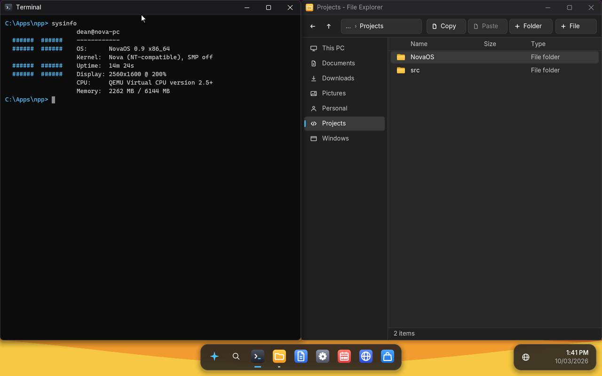

## Contents

- [What runs on it](#what-runs-on-it)
- [Screenshots](#screenshots)
- [Try it](#try-it)
- [Build it](#build-it)
- [What is inside](#what-is-inside)
- [How it works](#how-it-works)
- [Status and roadmap](#status-and-roadmap)
- [Testing](#testing)
- [Contributing](#contributing)
- [Documentation](#documentation)
- [License](#license)

## What runs on it

Every program below is the official Windows release, downloaded and run
unchanged.  Most of them are exercised every night by the app corpus, which
installs each one, drives it and compares a screenshot against a reference.

| | |
|---|---|
| **Developer tools** | 7-Zip, Git for Windows, ripgrep, fd, jq, bat, fzf, Neovim, ffmpeg |
| **Runtimes** | Python with NumPy, Node.js, .NET, Java (Temurin), the Visual C++ runtime |
| **Desktop apps** | Firefox, Thunderbird, qBittorrent, OBS Studio, LibreOffice (Writer and Calc), VLC, Audacity, Notepad++, WinMerge, Inkscape, Krita, GIMP, ShareX, KeePassXC, SumatraPDF |
| **Games** | OpenTTD, Beneath a Steel Sky on ScummVM, Teeworlds, OpenTyrian, Cave Story, SuperTux, Chocolate Doom, Squash the Creeps (Godot 4, Direct3D 12) |
| **Graphics** | OpenGL through Mesa; Vulkan through Mesa or Venus; Direct3D 9 to 11 through DXVK; Direct3D 12 through VKD3D-Proton; DirectDraw through cnc-ddraw |
| **Installers** | `.msi` packages (with their dialogs, custom actions and services), NSIS and Inno Setup |

[docs/compatibility.md](docs/compatibility.md) rates every program that has
been tried, from Platinum to Borked in the style of ProtonDB, with what works,
what does not and how it was checked.  Notable gaps: Steam and GOG Galaxy
install but cannot sign in yet, most of the ArtCraft apps are only partly
checked, and Roblox stops at its anti-cheat check.

## Screenshots

All taken from NovaOS running in QEMU.  [docs/screenshots/README.md](docs/screenshots/README.md)
says how each one was made and has more of them: Settings, File
Explorer, Notepad, Calendar, more programs and the graphics tests.

| | | |
|---|---|---|
| 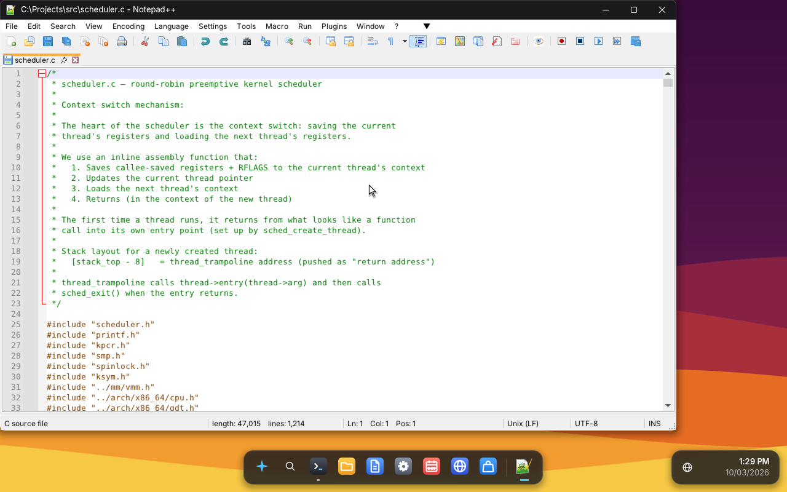 | 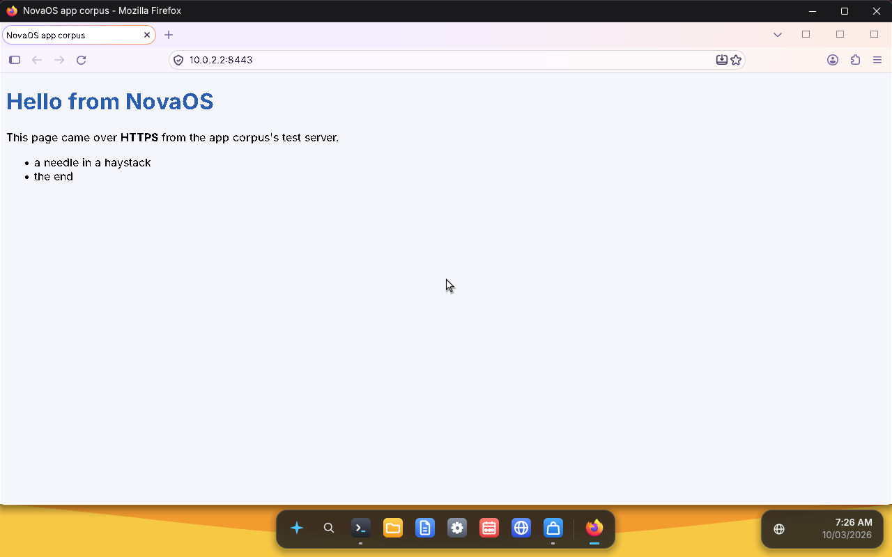 | 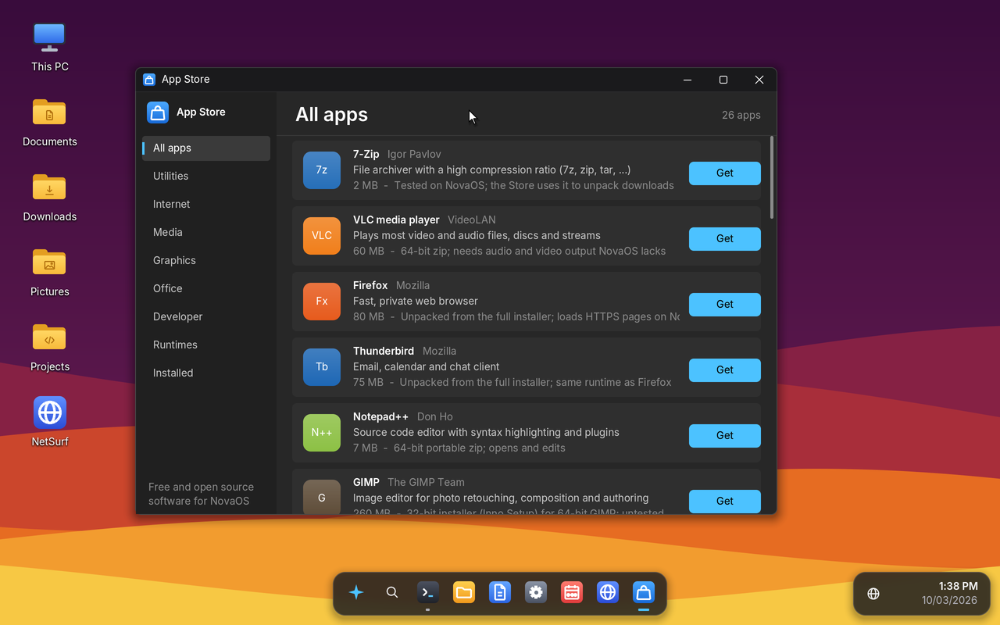 |
| Notepad++ editing NovaOS's own scheduler | Firefox loading a page over HTTPS | The App Store, which installs real Windows programs |
| 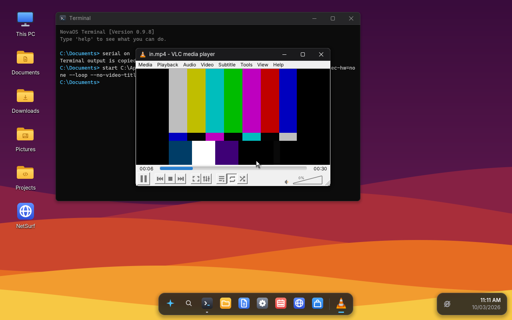 | 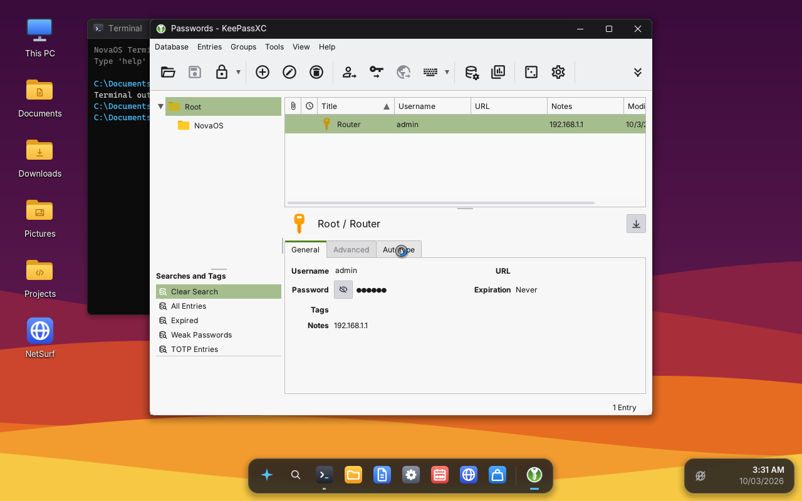 | 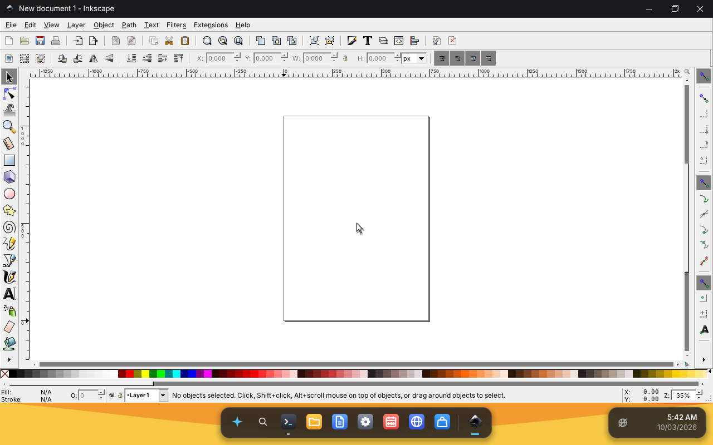 |
| VLC playing an H.264 video with sound | KeePassXC (Qt) with an open database | Inkscape (GTK) with a new document |
| 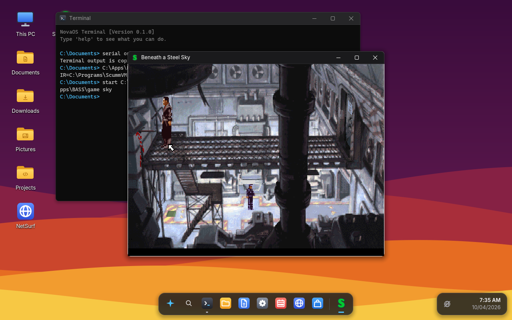 | 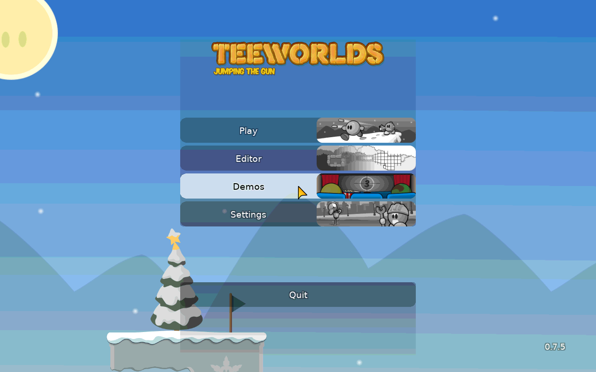 | 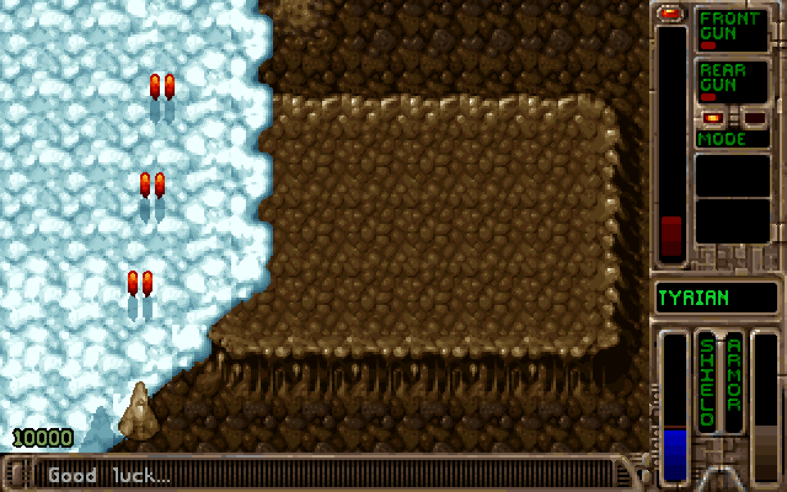 |
| Beneath a Steel Sky on ScummVM, installed with its own installer | Teeworlds in full screen, with music | Tyrian on OpenTyrian, Direct3D 9 through DXVK |
| 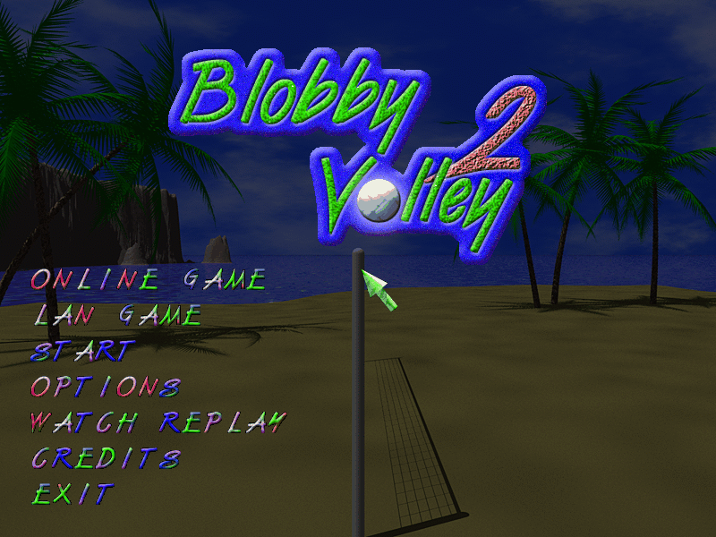 | 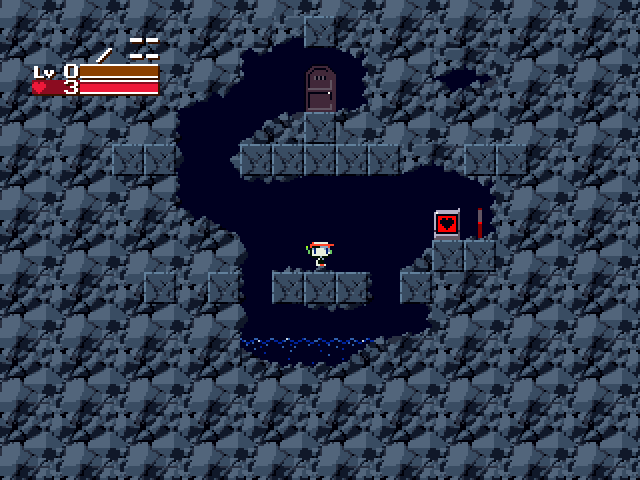 | 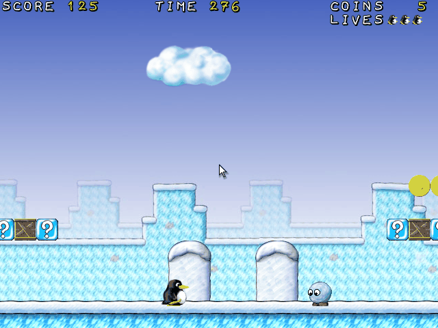 |
| Blobby Volley 2, exclusive full screen at 800x600 | Cave Story, DirectDraw at 640x480 | SuperTux, played with an Xbox 360 pad |
|  |  |  |
| Krita with a drawing saved as `.kra` | LibreOffice Calc with an `.xlsx` spreadsheet | Thunderbird reading a mail |
|  |  |  |
| The Start menu on the Aurora desktop | Settings: the four desktop themes | The Terminal running `sysinfo` and `devices` |
|  |  |  |
| Device Manager: devices by type, with each one's driver, IDs and resources | Event Viewer: the Application log, with an event's message and details | WinSCP's login window |
|  |  |  |
| Calculator on Windows Calculator's own engine | Scientific: 25! exactly | Programmer: 255 in four bases |

## Try it

NovaOS boots on UEFI machines.  The ISO is both a live system and an
installer.

**1. Get the ISO.**  Download `nova.iso` and `nova.iso.sha256` from the
[latest release](https://github.com/dean-plude/os/releases/latest), or take
the build of the current `main` branch from the rolling
[`latest`](https://github.com/dean-plude/os/releases/tag/latest) release,
which CI republishes after every green push to `main`.  Check the download
with `sha256sum -c nova.iso.sha256`.

**2. Boot it in QEMU** (Ubuntu or Debian: `sudo apt install qemu-system-x86 ovmf`):

```bash
truncate -s 8G disk.img
cp /usr/share/OVMF/OVMF_VARS_4M.fd OVMF_VARS.fd
qemu-system-x86_64 -machine q35 -m 2G -smp 4 \
  -drive if=pflash,format=raw,unit=0,readonly=on,file=/usr/share/OVMF/OVMF_CODE_4M.fd \
  -drive if=pflash,format=raw,unit=1,file=OVMF_VARS.fd \
  -drive file=disk.img,format=raw -cdrom nova.iso
```


NovaOS starts live from the disc and offers **Install NovaOS**, which
partitions `disk.img` (GPT, an EFI System Partition and a data partition
for drive C:).  Afterwards, run the same command without `-cdrom nova.iso`
to start the installed system; the first start walks you through your
name, time zone, keyboard layout and display resolution.

**Other ways to run it:**

- **A Mac:** [docs/macos.md](docs/macos.md) (Apple Silicon and Intel).
- **Hyper-V** (Generation 2 VM): [docs/hyperv.md](docs/hyperv.md).
- **A real PC from a USB stick** (UEFI, Secure Boot off): write the ISO with
  `dd`, Rufus in DD mode or balenaEtcher.  NovaOS has not yet been checked on
  real hardware; [docs/hardware.md](docs/hardware.md) lists what is expected
  to work on the reference laptop, and [docs/install-and-power.md](docs/install-and-power.md)
  covers installing on one.

The [user guide](docs/user-guide.md) covers the desktop, the built-in apps
and installing programs.

## Build it

The build host is Linux (Ubuntu or Debian; on Windows use WSL2, on a Mac see
[docs/macos.md](docs/macos.md)).

```bash
sudo apt install cmake nasm clang lld llvm libc++-dev gcc-mingw-w64-x86-64 \
                 python3 git p7zip-full qemu-system-x86 ovmf mtools dosfstools xorriso dosbox
mkdir build && cd build
cmake ..
make -j$(nproc)
cmake --build . --target run
```

`make` builds the bootloader, the kernel with the whole userland inside it,
and the boot disk `build/nova.img`; the `run` target boots it in QEMU.
The build downloads Firefox, Mesa and Microsoft's Windows Driver
Frameworks source, so it needs a network connection.  `run` starts a small
VM for a quick look; to install programs, give it 2 GB as shown in
[docs/building.md#running-in-qemu](docs/building.md#running-in-qemu).
The first build also compiles the NetSurf browser; set `NOVA_NO_NETSURF=1`
to leave it out, and `NOVA_NO_WOW64=1` to skip the 32-bit userland.  To make
an ISO from your build, run
`scripts/create-iso.sh nova.iso build/bootx64.efi build/kernel.elf`.
[docs/building.md](docs/building.md) covers the build options, QEMU
settings, the persistent data disk, putting your own programs on it,
running the tests and debugging.

## What is inside

A short tour; [docs/inside.md](docs/inside.md) has the full one, and
[docs/HISTORY.md](docs/HISTORY.md) records how every part was built.

<!-- BEGIN generated:inside -->

- **Boot**: a UEFI bootloader loads the ELF kernel from the EFI System Partition or the ISO; the same ISO runs live and installs NovaOS to a SATA or NVMe disk.
- **Kernel** (`kernel/`): an NT-style executive with objects and handles, processes and threads, virtual memory, security, a registry, the Windows 10 1903 system-call table and an SMP scheduler with NT's priorities.
- **Built-in drivers**: SATA and NVMe disks, GPT, FAT and NTFS, USB (xHCI to UHCI: HID, storage, audio, game controllers, UVC cameras), Intel and virtio networking, HD Audio, display adapters, ACPI power management and a Plug and Play device tree.
- **Windows drivers** (`kernel/nt/`): unmodified Windows `.inf`/`.sys` packages on an NT driver interface (WDM, KMDF, UMDF, NDIS, Storport, USB, display-only WDDM, with the WDDM render path begun: `D3DKMT*` calls, video memory and fences on a Basic Render adapter), matched and downloaded by hardware ID and checked against Windows' signing policy.
- **Networking**: lwIP over IPv4 and IPv6 with DHCP, SLAAC, stateful and stateless DHCPv6 and DNS, TLS 1.3/1.2 on Mbed TLS, Winsock, and `winhttp` with HTTP/2.
- **Desktop** (`kernel/wm/`, `kernel/apps/`): a software-rendered window manager and shell with a dock, Start menu search, File Explorer, Terminal, Settings, Task Manager, Disk Management, Calculator and the App Store.
- **Windows userland** (`userland/`): about 115 system DLLs written for NovaOS, 64- and 32-bit, from `ntdll`, `kernel32`, `user32` and `gdi32` to COM, the C and C++ runtimes, Windows Installer, Schannel, DirectWrite, Direct2D and ICU.
- **Graphics**: a CPU-rendered GDI and desktop, OpenGL 4.5 on Mesa's llvmpipe built in, and Vulkan, DXVK and VKD3D-Proton from the App Store, on the CPU or, under QEMU, on the host's GPU through virtio-gpu.
- **Program support**: the PE loader, 32-bit programs through a WoW64-style `ntdll`, x64 and x86 structured exceptions, consoles and ConPTY, COM between processes, Windows Installer, services and scheduled tasks.
- **Apps and updates**: the App Store downloads open-source Windows programs and runtimes (with a badge for each one the nightly tests verify), `winget` installs them and packages from the winget community repository from the command line, Firefox is bundled as the default browser, and installed systems update themselves from an update channel that can be signed (the release key is not shipped yet).

<!-- END generated:inside -->

### Repository layout

| Directory | What it holds |
|---|---|
| `bootloader/` | The UEFI bootloader (a PE32+ EFI application) |
| `kernel/` | The kernel: `ke` scheduler and SMP, `mm` memory, `ob` `ps` `se` `cm` `io` executive managers, `um` the Windows program environment (processes, loader, NT services, WoW64, registry, sockets, consoles), `nt` the Windows driver interface (WDM, KMDF/UMDF hosts, NDIS, Storport, dxgkrnl), `drivers` and `hal` NovaOS's own drivers, `fs` file systems, `net` networking, `gdi` and `wm` drawing and the window manager, `apps` the built-in apps |
| `userland/` | The Windows DLLs (one directory each, described by its `dll.json`), the C and C++ runtimes, and `programs/` (system programs, samples and self-tests) |
| `third_party/` | Vendored libraries, each under its own licence (see [License](#license)) |
| `tools/` | Host tools: the userland build, test runners (`selftest.py`, `appcorpus.py`), `docgen.py`, release tools |
| `tests/` | CI self-tests and the nightly app corpus, one file per test, and reference screenshots |
| `scripts/` | Disk, ISO and QEMU scripts |
| `docs/` | Documentation, and the one-file-per-item fragments the generated parts of it are built from |

## How it works

[docs/design/architecture.md](docs/design/architecture.md) explains each of
these decisions and why it was made.

- **Clean-room, but ABI-faithful.**  Every DLL is NovaOS's own code, but
  system-call numbers, `NTSTATUS` codes and structure layouts (PEB, TEB,
  `KUSER_SHARED_DATA`, `CONTEXT`) match Windows 10 1903 x64, so unmodified
  binaries, runtimes and JIT compilers find what they expect.  `abitest`
  checks this in CI.
- **Both bitnesses natively.**  x64 code runs in long mode; x86 code runs in
  compatibility mode through a 32-bit `ntdll`, the way WoW64 does it.
- **Windows drivers, the Windows way.**  NovaOS loads real Windows driver
  packages (`.inf`, `.sys` and firmware) unchanged on its own NT kernel-mode
  driver interface, matches them to devices by hardware ID and follows the
  Windows signing policy.  See [docs/drivers.md](docs/drivers.md).
- **The window system lives in the program.**  `user32` keeps each process's
  window tree; the kernel composites top-level windows from bitmaps the
  programs own.
- **CPU rendering first, GPU where available.**  GDI is a CPU rasteriser with
  integer HiDPI scaling, and OpenGL and Vulkan fall back to Mesa's software
  drivers.  Under QEMU, Venus and virgl give Vulkan and OpenGL a real GPU;
  Intel's own driver for the reference laptop's GPU is the next step
  ([docs/design/intel-gpu.md](docs/design/intel-gpu.md)).

## Status and roadmap

**NovaOS 0.1.0** was released on 4 October 2026, and the rolling `latest`
build follows `main`.  Since then the kernel's console and NTFS work and the
Windows driver model have been finished, and a performance budget guards
boot time and Firefox start-up in CI.

What 0.1 still owes is a boot on the reference PC, a ThinkPad T14 Gen 4: all
testing so far has been in QEMU (and in CI), and nothing has yet run on a real
PC or on Microsoft Hyper-V.  The next phases are:

| Phase | Focus |
|---|---|
| 23 | Finish 0.1 on real hardware: check the T14, fix its first missing driver, a week of clean nightly runs, Hyper-V input, update signing |
| 24 | Gaming: Steam and GOG Galaxy sign-in, installing and playing a game from a store |
| 25 | GPU: Intel Iris Xe through Intel's own driver, then a second monitor |
| 27 | Everyday apps: a larger app corpus, an office suite, the public web over the T14's own network |
| 28 | Laptop hardware: Wi-Fi, Bluetooth, camera, battery life, a second reference PC |
| 29 | NovaOS 0.2 on both reference PCs |
| 31 | DOS programs: MS-DOS 4.0 built from Microsoft's source, on a real-mode CPU in a NovaOS console window, as NTVDM did |

[docs/ROADMAP.md](docs/ROADMAP.md) has every step, what has been done and
what counts as done.

## Testing

Every pull request is built and boot-tested in QEMU by GitHub Actions: the
core, network, device and graphics self-test suites run inside NovaOS, and a
performance job fails the check if boot time, Firefox's start or SMP scaling
regress badly.  Every night the app corpus installs and drives dozens of real
Windows programs and games.  A green push to `main` republishes the `latest`
ISO.

- [docs/testing.md](docs/testing.md): every test and corpus program, and how
  to read the serial log, `trace` output and crash reports.
- [docs/ci.md](docs/ci.md): how the CI jobs are organised.
- [docs/building.md#tests](docs/building.md#tests): running the tests
  yourself.

## Contributing

Many changes are in flight at once, so the repository keeps one file per
item (a DLL, a test, a documentation entry) to stop parallel pull requests
from colliding.  [CONTRIBUTING.md](CONTRIBUTING.md) says where each kind of
change goes and how the generated documentation works.  Every pull request
should pass CI's three checks before it merges: **Checks** (conflict
markers, manifests, generated docs), **Build and boot-test**, and
**Graphics tests**.

Two rules shape the work: NovaOS is fixed to suit the Windows program, never
the other way round, and existing MIT, BSD or zlib licensed code is reused
before new code is written.

## Documentation

| Using NovaOS | |
|---|---|
| [User guide](docs/user-guide.md) | Trying it, installing it, the desktop and its apps, installing programs |
| [Compatibility](docs/compatibility.md) | Every program tried, and how well it runs |
| [App Store catalog](docs/app-store-catalog.md) | How the App Store's list of programs is defined |
| [Updates](docs/updates.md) | The signed update channel |
| [macOS](docs/macos.md) | Running and building on a Mac |
| [Hyper-V](docs/hyperv.md) | Running in a Hyper-V virtual machine |
| [Hardware](docs/hardware.md) | The reference PC and every driver NovaOS has |
| [Installing and power](docs/install-and-power.md) | Installing on a laptop, sleep and power, the T14 checklist |

| Developing NovaOS | |
|---|---|
| [Building](docs/building.md) | Build options, QEMU, the data disk, tests, debugging |
| [Testing](docs/testing.md) and [CI](docs/ci.md) | The self-tests, the app corpus and the CI jobs |
| [Contributing](CONTRIBUTING.md) | Where each kind of change goes |
| [Releasing](docs/releasing.md) | Tagged releases and the rolling `latest` build |
| [Architecture](docs/design/architecture.md) | The key design decisions |
| [Inside NovaOS](docs/inside.md) | A tour of every part |
| [Early architecture](docs/phase1-architecture.md) | Boot flow, address-space layout, the early kernel |
| [DOS programs](docs/dos.md) | MS-DOS 4.0 built from Microsoft's source and booted by `ntvdm` in a console window; DOS `.COM` and `.EXE` programs start from `cmd`, Explorer and `CreateProcess`, and the DOS game bootRogue plays |
| [Drivers](docs/drivers.md) and [Windows driver design](docs/design/windows-drivers.md) | Running Windows driver packages |
| [Desktop design](docs/design/native-desktop.md) | How the Aurora desktop maps its design reference onto the native shell |
| [Intel GPU design](docs/design/intel-gpu.md) | The plan for the reference laptop's GPU |
| [Ethernet](docs/ethernet.md) | The Intel Ethernet driver |
| [Building Firefox](docs/building-firefox.md) | How the bundled Firefox is fetched and packaged |
| [Roadmap](docs/ROADMAP.md) and [History](docs/HISTORY.md) | What comes next, and what every phase added |

## License

NovaOS is licensed under the Apache License 2.0 (`LICENSE`).  The operating system itself (kernel, bootloader,
system DLLs, C runtime, desktop and apps) contains no GPL code.  Bundled
third-party code keeps its own licence (<!-- BEGIN generated:licenses -->lwIP: BSD 3-clause; Mbed TLS: Apache-2.0; Monocypher: BSD-2-Clause (or CC0); nghttp2: MIT; libxml2: MIT; mujs: ISC; uACPI: MIT; Intel's e1000 shared code (FreeBSD's, for the I219 bring-up in `kernel/drivers/e1000.c`): BSD 3-clause; OpenBSD's `pchgpio(4)` (Intel GPIO controllers' register layout and pad groups, in `kernel/hal/gpio.c`): ISC; musl's libm and complex functions: MIT; ICU: Unicode License v3 (`third_party/icu/LICENSE`); kernel32's locale table, from .NET: MIT; the time zone table (`kernel/ke/tzdata.inc`): zone names from Unicode CLDR's windowsZones, Unicode License v3; rules from the IANA tz database, public domain; HarfBuzz: MIT; the keyboard layouts (`userland/include/kbdlayouts.h`): xkeyboard-config, MIT/X11 licence, compiled by libxkbcommon (MIT); FreeType: the FreeType License (BSD-style; portions of this software are copyright © 2024 The FreeType Project (www.freetype.org), all rights reserved); Boost.Math (the C++17 special math functions in `msvcp140_2.dll`): Boost Software License 1.0; Microsoft's C++ standard library (STL): Apache-2.0 WITH LLVM-exception; plutovg: MIT (with FreeType-licensed rasteriser and stroker files); Mesa's llvmpipe (mesa-dist-win 24.2.4, the built-in OpenGL): MIT; Mesa's Venus and virgl (`third_party/mesa-venus`, the App Store's Venus): MIT; the SPIR-V headers (`third_party/spirv-headers`, for the HLSL compiler in `d3dcompiler_47.dll`): MIT; Inter and Cascadia Mono: SIL OFL 1.1; Noto Sans Arabic and Devanagari: SIL OFL 1.1; DejaVu Sans Mono: Bitstream Vera licence; stb_truetype/stb_image: public domain or MIT; FAudio: zlib; Windows Calculator's CalcManager (`third_party/calcmanager`, `calc.exe`): MIT; TinySoundFont: MIT; Sound Open Firmware (Intel's signed audio DSP firmware, built in only when tools/fetch_sof_firmware.py fetched it): BSD 3-clause with Intel's firmware licence; cnc-ddraw (`third_party/cnc-ddraw`, `ddraw.dll`): MIT, with lodepng: zlib; The default firmware set (`tools/firmware.json`, files from linux-firmware for Intel graphics and Intel and Qualcomm Wi-Fi and Bluetooth, built in only when tools/fetch_firmware.py fetched them): redistributable unchanged under each vendor's licence (`LICENSE.i915`, `LICENCE.iwlwifi_firmware`, `LICENCE.ibt_firmware`, `LICENSE.QualcommAtheros_ath10k` with `NOTICE.qca`), kept beside the files in `C:\Windows\Firmware\LICENSES`; Microsoft's vhidmini2 driver sample (`C:\Tests\VhidMini\vhidmini.sys`, a test fixture fetched from Windows-driver-samples at a pinned commit and built unchanged by `tools/kmdf/build_kmdf.py`): Microsoft Public License (MS-PL), its text in `C:\Tests\VhidMini\LICENSE.txt`; hidapi (`third_party/hidapi`, its Windows backend in the `hidapitest` self-test): BSD-style (hidapi's own licence choice; GPL v3 and the original HIDAPI licence are the others); MS-DOS 4.00 (`C:\Windows\System32\DOS\MSDOS.IMG`, built from Microsoft's source at github.com/microsoft/MS-DOS by `tools/msdos/build_msdos.py` and booted by `ntvdm.exe`): MIT, its text in `C:\Windows\System32\DOS\LICENSE.TXT`; bootRogue (`third_party/bootrogue`, assembled as `C:\Tests\Dos\ROGUE.COM`, a DOS game the `dostest` self-test plays): BSD 2-clause, its text in `C:\Tests\Dos\ROGUE-LICENSE.TXT`; Windows Runtime metadata from windows-rs (`third_party/winmd`, read by `tools/winrt/abigen.py`): MIT; Microsoft's XAML framework, WinUI (`third_party/microsoft-ui-xaml`, its IDL and the XAML core's lower layers so far: the lowest components, the type metadata and `CDependencyObject`'s property system): MIT; Microsoft's Windows Implementation Library, WIL (`third_party/wil`, which the XAML sources are written on): MIT; Firefox: Mozilla Public License 2.0 and bundled third-party notices (unmodified official Mozilla payload).<!-- END generated:licenses -->).
The Win32 API is implemented clean-room from Microsoft's public
documentation, with the ReactOS and Wine sources as references for
behaviour, but written independently.

Three bundled components are not MIT, and each is kept separate from the
operating system:

- **NetSurf** (`third_party/netsurf/netsurf`) is GPL-2.0; its libraries are
  MIT, zlib and libpng licensed (see `third_party/netsurf/NOVA-VENDOR.txt`).
  `netsurf.exe`, NetSurf linked with NovaOS's MIT glue in `userland/netsurf`,
  is a separate program distributed under the GPL-2.0 with its complete
  source in this repository; the kernel image only carries it as a file for
  drive C:.  Build with `NOVA_NO_NETSURF=1` for an image without it.
- **vkd3d-shader** (`third_party/vkd3d-shader`), Wine's HLSL compiler, is
  LGPL-2.1 or later.  It is compiled into `d3dcompiler_47.dll` alone, whose
  own sources (`userland/d3dcompiler_47`, MIT) use it only through its public
  API.  Its complete source and NovaOS's changes to it are in this
  repository, and a changed copy can be rebuilt into that DLL (see
  `third_party/vkd3d-shader/NOVA-VENDOR.txt`).
- **7-Zip** (`third_party/7z2603-x64.exe`) is Igor Pavlov's unmodified
  installer, kept as a test case under [7-Zip's own licence](https://www.7-zip.org/license.txt);
  it is not part of NovaOS.
