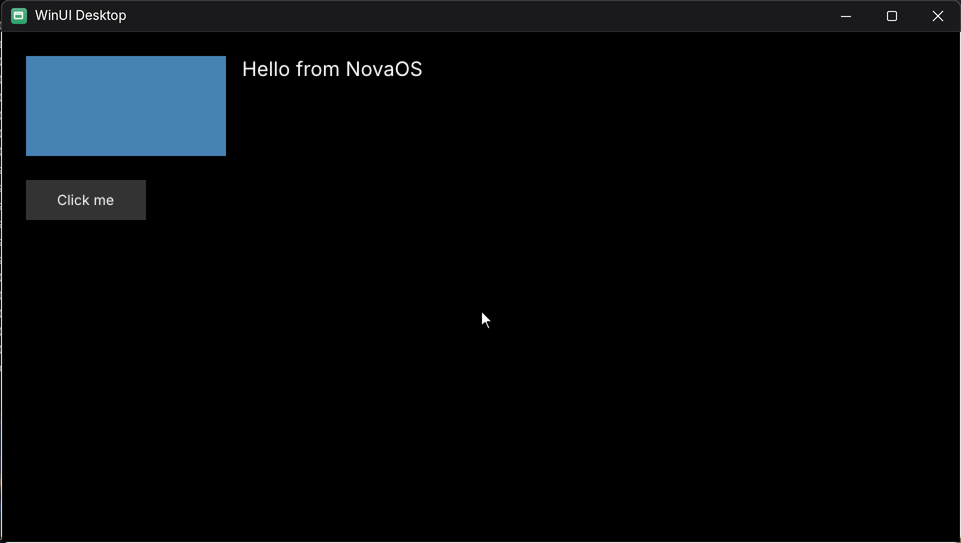

## A XAML page draws

The seventh part of step 32.4 of `Windows.UI.Xaml` on NovaOS
([design](../design/windows-ui-xaml.md)), in the Phase 32 push: a WinUI 3
page in a `Window` is laid out and drawn, built from Microsoft's sources.

- **Layout:** the control styles load now that the theme transitions are
  built, and measure and arrange run over the page (scroll data, geometry
  clips, transforms, the core `SolidColorBrush`, text options).
- **Drawing:** the framework's render walk, hardware walk and composition
  nodes, its DirectWrite text renderer and Direct2D text drawing context,
  and its DirectComposition surfaces, all from Microsoft's sources.
- **NovaOS's side:** its `XamlIsland` now asks for the island's content
  (without it the island's root visual was never connected) and its own
  `CompositionSurfaceHelper` (the Windows App SDK's is closed);
  `d2d1.dll` answers `ID2D1DeviceContext1` to `7`; `dcomp.dll`'s
  compositor gained mask brushes (XAML draws text as its glyphs' alpha
  over a colour brush), surface brush transforms and clip transforms.
- **Window.Close:** the page's window now closes and the app exits
  cleanly.
- **Test:** `xamlpagetest` draws a `Border`, a `TextBlock` and a
  `Button` and screenshots them (64-bit).
- **Next (32.4):** typing into a `TextBox` and clicking the `Button`.
